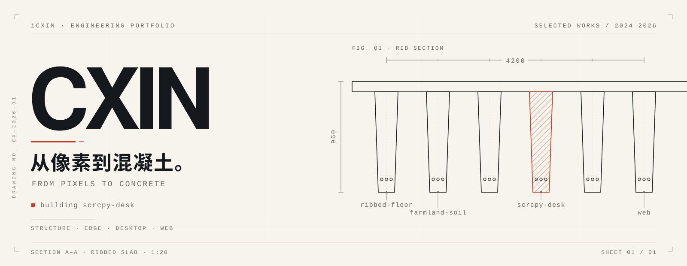
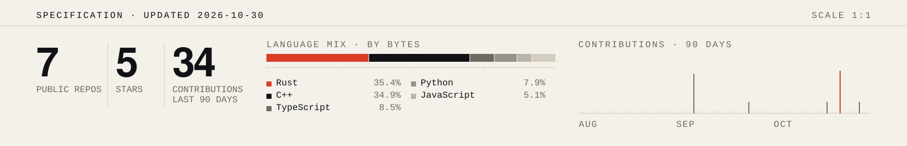

<div align="right"><sub><code>iCxin · profile</code></sub></div>

<picture>
  <source media="(prefers-color-scheme: dark)" srcset="./assets/hero-dark.svg">
  <source media="(prefers-color-scheme: light)" srcset="./assets/hero-light.svg">
  
</picture>

<div align="right"><sub><code>CX-2026-01</code> · 肋梁截面 A–A · 1:20</sub></div>

> 白天让结构算得准一点，晚上让桌面用得顺一点。
> Structural engineering by day, desktop tools by night.

| | |
|:--|:--|
| **栈** | `Rust` · `C#` · `C++17` · `TypeScript` · `Python` |
| **范围** | 结构计算 / 边缘传感 / 桌面工具 / 前端 |
| **状态** | 在打磨 [scrcpy-desk](https://github.com/iCxin/scrcpy-desk) |

---

## 01 · 正在做

主力是 [scrcpy-desk](https://github.com/iCxin/scrcpy-desk)：给 scrcpy 配一个真正像桌面应用的界面。
同时把 [ribbed-floor](https://github.com/iCxin/ribbed-floor-design-system) 的有限元内核、[farmland-soil](https://github.com/iCxin/farmland-soil-collection-system) 的采集终端往「能交付」推进。

## 02 · 作品

| | 项目 | 一句话 | 栈 |
|:--:|---|---|---|
| `01` | [ribbed-floor-design-system](https://github.com/iCxin/ribbed-floor-design-system) | 水工肋形楼盖：有限元内核 + 按规范配筋 | `C++17` |
| `02` | [farmland-soil-collection-system](https://github.com/iCxin/farmland-soil-collection-system) | 田间土壤参数采集终端，边缘融合与实时面板 | `C++17` |
| `03` | [scrcpy-desk](https://github.com/iCxin/scrcpy-desk) | 把手机投屏做成一个正经桌面应用 | `Rust` |
| `04` | [qqmusic-lyric-guard](https://github.com/iCxin/qqmusic-lyric-guard) | 让 QQ 音乐歌词的「解锁」胶囊根本画不出来 | `C#` |
| `05` | [xiaomi-mimo-usage](https://github.com/iCxin/xiaomi-mimo-usage) | 读本地 SQLite 的用量看板，运行时一次网都不出 | `Python` |

其余「双击就能跑」的单文件小实验已收进私有仓库，不再单独列出。

## 03 · 范围

| 层 | 在做什么 |
|:--|:--|
| **结构 / 计算** | 有限元、配筋优化、参数化设计——把规范条文变成可执行的约束 |
| **边缘 / 硬件** | 传感器采集、融合、MQTT/CoAP 上行，跑在资源很少的板子上 |
| **桌面** | 原生窗口、Win32 的细活、把网页装进一个不像浏览器的壳 |
| **前端** | 数据看板、交互原型，以及周末用来偷懒的单文件页面 |

## 04 · 规矩

1. **能本地跑，就别上云。** 数据先留在自己的机器里，网络是功能，不是前提。
2. **单文件也是一种工程。** 双击就能用的东西，比需要读 README 才能用的东西更接近「工具」。
3. **先量，再改。** 手感不是证据，曲线才是。

## 05 · 规格

| 条目 | 参数 |
|:--|:--|
| 型号 | `CXIN-01` |
| 入网 | 2024.10 |
| 常在语言 | Rust · C# · C++17 · TypeScript · Python |
| 擅长 | 把手工活变成能重复跑的东西 |
| 已知缺陷 | 项目比人多；喜欢给已经能跑的东西再加一层抽象 |
| 保修 | 暂无 |

---

<div align="center">

<picture>
  <source media="(prefers-color-scheme: dark)" srcset="./assets/stats-dark.svg">
  <source media="(prefers-color-scheme: light)" srcset="./assets/stats-light.svg">
  
</picture>

</div>

<details>
<summary><code>$ whoami</code></summary>

<br>

```text
cxin@bench:~$ whoami
cxin — 一个用代码同时画图、焊板、算配筋的人

cxin@bench:~$ ls ~/work
structure-fem/    edge-sensors/    desktop-tools/    web/

cxin@bench:~$ cat philosophy.txt
"能用"比"优雅"重要，
"优雅"比"能用"活得久。
```

</details>

---

<div align="right"><sub>从像素到混凝土 · <a href="https://github.com/iCxin?tab=repositories">所有仓库</a> · 插图与图表由 <a href="./scripts/">scripts/</a> 生成</sub></div>
